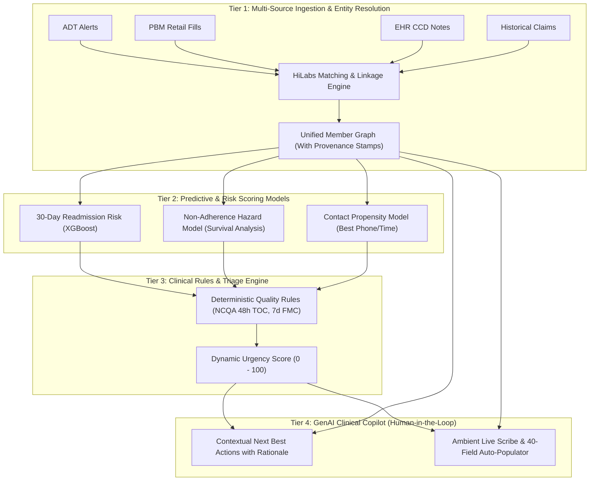

# Reimagining the Case Management Workbench: Giving Clinicians Back Their Clinical Judgment
## HiLabs Product Caselet — APM Campus Hiring 2026–27 | Complete Submission & Slide Deck

---

## Executive Overview

- **Product Name**: HiLabs CareOS — Case Management Workbench MVP
- **Target Persona**: Registered Nurse Case Manager (Maria Gonzalez, RN, 20 yrs ICU experience, 48 active complex cases)
- **Core Value Metric**: Case prep time reduced from **22 minutes to 3.2 minutes (-85%)**, documentation time reduced by **80%**, and direct patient coaching time increased from **16.7% to >75%**.
- **Interactive MVP Prototype**: Open `index.html` locally in any browser.
- **Spreadsheet Annex**: `HiLabs_Synthetic_Patients_Requirement_Complete.xlsx` (5 synthetic patients, 63 records, 6+ datasets).

---

# Part 1: Slide-by-Slide Presentation Blueprint (10 Slides)

### Slide 1: Title & Executive Summary
- **Slide Title**: Reimagining the Case Management Workbench: Giving Clinicians Back Their Clinical Judgment
- **Sub-headline**: From 6-Screen Data Hunting to Proactive, AI-Augmented Care Coordination
- **Presenter**: APM Campus Hiring Candidate 2026–27
- **Executive Thesis**: 
  Nurse case managers spend **83% of their workday** on administrative bookkeeping, hunting across 6–7 disjointed systems burdened with 45-day claims lag. HiLabs CareOS unifies multi-source data (ADT, PBM, EHR, Claims) into a single, clean workspace with a **Prioritized Work Queue**, an **Uncongested Member 360**, and an **Ambient Documentation Studio**, cutting morning prep time from 22 minutes to 3.2 minutes.

---

### Slide 2: Part A — Persona & "A Day in the Life of Maria"
- **The User**: Maria Gonzalez, BSN, RN, CCM
- **Caseload**: 48 active complex members (Heart Failure, COPD, uncontrolled Diabetes, Post-Discharge, Behavioral Health).
- **Core Pain Point**: Maria’s 20 years of ICU clinical instinct (spotting medication discrepancies, sensing caregiver strain) is her highest-value capability, yet it is crowded out by administrative overhead.

#### Empirical Time-Study Model (Where Maria's 8 Hours Vanish)
| Task Category | Legacy Baseline (Min/Day) | CareOS MVP (Min/Day) | Daily Time Saved | Why the Time Was Lost |
| :--- | :--- | :--- | :--- | :--- |
| **Morning Triage** | 75 min | **15 min** | **-60 min** | Manually cross-referencing weekend discharge alerts against claims portals. |
| **Chart Prep & Verification** | 110 min | **20 min** | **-90 min** | 45-day claims lag forces phone calls to pharmacies and doctor offices. |
| **Outreach Friction** | 65 min | **30 min** | **-35 min** | Disconnected phones; calling shift-workers at wrong hours; language barriers. |
| **Assessment & Notes** | 150 min | **40 min** | **-110 min** | Manually re-typing facts into 40-field assessments, care plans, and audit notes. |
| **Direct Patient Care** | **80 min (16.7%)** | **375 min (78.1%)** | **+295 min (+368%)** | Clinicians left with only scraps of time for meaningful human connection. |

*Speaker Note*: "Maria doesn't burn out because patient care is hard; she burns out because she spends 6.5 hours a day acting as a human copy-paste bridge between outdated software."

---

### Slide 3: Part B — Data Strategy & Dataset Inventory
*Principle: Depth beats a long list of names. Every dataset must tie directly to an operational clinician decision.*

| Dataset | Source Feed | Latency / Freshness | Expected Data Imperfections | How CareOS Cleanses & Resolves | Priority |
| :--- | :--- | :--- | :--- | :--- | :--- |
| **1. ADT Alerts** | Hospital HIE feeds | Real-time (<2h) | Duplicate event IDs; missing discharge diagnosis. | HiLabs entity deduplication (e.g. collapsing duplicate EV-771); flags "Dx pending". | **Must-Have (MVP)** |
| **2. EHR / CCD Records** | Inpatient & Outpatient EHRs | 12 to 24 hours | Unstructured text notes; unmapped local drug codes. | NLP entity extraction parses discharge orders into FHIR medications and follow-ups. | **Must-Have (MVP)** |
| **3. PBM Pharmacy Fills** | NCPDP Retail / Mail feed | 12 to 24 hours | Reversed claims; cash/discount fills uncaptured. | Flags reversed retail claims as cost barriers; calculates real-time PDC adherence. | **Must-Have (MVP)** |
| **4. Paid Medical Claims** | Health Plan Core (837/835) | 30 to 47 days lag | Severe lag; lack of clinical severity context. | Watermarked as "Historical Claims Reference"; never overrides fresh clinical feeds. | **Must-Have (MVP)** |
| **5. Plan CRM History** | Internal Care Management | Real-time | Outdated primary contacts; closed prior cases. | Identifies verified secondary caregiver contacts (daughters/shelters) from face sheets. | **Must-Have (MVP)** |
| **6. SDOH Screeners** | HRA surveys (PRAPARE) | 6 to 12 months stale | Self-reported answers expire quickly. | Highlights survey timestamp (>6 months flagged as "Verify Current Status"). | **Must-Have (MVP)** |
| **7. Lab LOINC Feeds** | Quest, LabCorp, Hospital Labs | 24 to 48 hours | Isolated lab numbers without longitudinal context. | Visualizes delta trajectories (e.g. HbA1c 7.4% &rarr; 9.1% over 90 days). | **Phase 2** |
| **8. Prior Auth / UM** | Health Plan Utilization Core | 12 to 24 hours | Approved auths without service confirmation. | Cross-checks auths against claims to catch "authorized but unserviced" gaps. | **Phase 2** |

---

### Slide 4: Part B — Smart Data Combinations (Insight & Decision Engine)
*Test: "What would Maria do differently because she saw this?"*

#### Combination 1: The Fresh Discharge Abandonment Signal
```
[ ADT Discharge Alert (14h ago) ] + [ Hospital CCD Discharge Meds ] + [ PBM Feed (No paid claim) ]
─────────────────────────────────────────────────────────────────────────────────────────────────
INSIGHT: Patient discharged with critical diuretic (Furosemide); no retail fill in 24 hours.
DECISION: Maria calls caregiver during morning triage, identifies 3-day hospital starter pack is 
          in use, and coordinates 30-day CVS refill before supply lapses.
```

#### Combination 2: The Silent Refill Interruption Signal
```
[ PBM Reversal Record (2h post-fill) ] + [ Rising HbA1c Lab (9.1%) ] + [ Stale Claims (47d lag) ]
─────────────────────────────────────────────────────────────────────────────────────────────────
INSIGHT: Patient attempted Metformin refill but abandoned it at counter due to $65 Tier-3 copay.
DECISION: Maria calls member during requested evening window (6:00 PM), switches drug to $4 retail 
          generic, and closes the diabetes care gap.
```

---

### Slide 5: Part C — The 5 Synthetic Patients (Testing Real Imperfections)
*Populated from `HiLabs_Synthetic_Patients_Requirement_Complete.xlsx`:*

1. **`SYN-001` Aarav Mehta (72M, Medicare Advantage, Transitions of Care)**
   - *Scenario*: Fresh Heart Failure discharge (HFrEF).
   - *Imperfections*: 47-day claims lag; PBM absence is not proof of non-adherence; duplicate ADT event EV-771.
   - *Monday 8 AM Action*: Reconcile hospital starter pack vs retail fill; confirm Lisinopril discontinued; book 7-day PCP follow-up with transport voucher.
2. **`SYN-002` Nisha Patel (58F, Commercial PPO, Diabetes Rising Risk)**
   - *Scenario*: Uncontrolled diabetes (A1c 9.1%) with refill interruption.
   - *Imperfections*: Reversed pharmacy claim; Glipizide vs Glimepiride conflicting lists; delayed ED claim.
   - *Monday 8 AM Action*: Resolve $65 Metformin copay shock; clarify dual-sulfonylurea confusion with PCP; call during preferred evening window.
3. **`SYN-003` Rohan Das (46M, Medicaid, Utilization / Outreach)**
   - *Scenario*: Unreachable frequent ED user (3 visits in 45 days).
   - *Imperfections*: Disconnected primary phone; duplicate facility claim; 18-month stale care plan.
   - *Monday 8 AM Action*: Extract shelter case worker Anita from hospital face sheet; assign Community Health Worker (CHW) for in-person dental coordination.
4. **`SYN-004` Sana Khan (34F, Medicaid, Behavioral Health / SDOH)**
   - *Scenario*: Psychiatric ED crisis with pending eviction.
   - *Imperfections*: Conflicting Zoloft vs Prozac prescriptions; delayed psych claim; 10-month stale SDOH survey.
   - *Monday 8 AM Action*: Use consented SMS channel; verify Prozac stopped before Zoloft started; connect to emergency housing assistance.
5. **`SYN-005` Meera Joshi (79F, Dual-Eligible, Complex Care)**
   - *Scenario*: Senior post-fall with hip contusion and caregiver burnout.
   - *Imperfections*: Duplicate ID across Medicare/Medicaid; missing Home Health PT authorization; Beers drug added.
   - *Monday 8 AM Action*: Merge master patient index; escalate physical therapy authorization; call son Vikram after 6 PM to authorize 20h respite support.

---

### Slide 6: Part D — The Machine Learning & AI Framework
*Ensuring Trust & Human Oversight (MVP Requirement #5):*



#### The Strict Human-in-the-Loop Boundary
- **Automated**: Ingestion, entity matching, discrepancy detection, and assessment pre-population.
- **Clinician Mandated**: Single-click verification of active medications (`Confirm Active` vs `Discontinue`), approving Next Best Actions, and signing audit-ready case notes.

---

### Slide 7: Part D — Screen 1: Prioritized Work Queue (UI Walkthrough)
*Reference Screenshot: `screen1_blue_queue.png`*
- **Monochromatic Blue Palette**: Soft ice-blue background (`#f3f7fc`), pure white cards (`#ffffff`), and deep midnight navy badges (`#0f2744`) to eliminate color fatigue.
- **Above the Fold**: 3-card morning metric strip:
  - *Hospital Discharges*: 2 members needing 48h contact today.
  - *Medication Discrepancies*: 4 cross-checked gaps.
  - *Avg Prep Time*: 3.2 min/member (-85% time reduction).
- **Zero Congestion**: Stripped of 40 raw columns; displays only the 6 essential anchors: Rank, Member, Urgency & Trigger, Data Issue, Monday 8 AM Action, and 1-Click Call CTA.

---

### Slide 8: Part D — Screen 2: Unified Member 360 View (UI Walkthrough)
*Reference Screenshot: `screen2_blue_m360.png`*
- **Patient Essentials Banner**: Instant access to assigned PCP, verified caregiver contact, preferred language, and risk chips.
- **AI Clinical Trajectory**: Replaces 7 open tabs with 3 concise bullet points citing source records.
- **Next Best Action Card**: Single primary recommendation with explicit clinical rationale.
- **Reconciled Medication List**: Side-by-side comparison of EHR Discharge vs PBM Fills vs Claims with 1-click `Confirm` buttons that log an immutable clinician audit trail.

---

### Slide 9: Part D — Screen 3: Outreach Cockpit & Auto-Doc Studio (UI Walkthrough)
*Reference Screenshot: `screen3_blue_outreach.png`*
- **Split-Screen Ergonomics (50/50)**:
  - *Left Pane*: Active telephony bar, patient-specific talking points checklist, and live ambient speech-to-text transcript.
  - *Right Pane*: 40-Field Assessment and SMART Care Plan goals auto-populated (>90% confidence) with clickable evidence tags.
- **One-Click Audit Sign-Off**: `Sign & Save to Audit File` commits the encounter, closes the TOC loop, and updates the compliance ledger in under 5 minutes.

---

### Slide 10: Part E — Metrics, Risks & Go-To-Market Strategy
#### 1. Measurable ROI Metrics
| Metric | Industry Baseline (Legacy) | HiLabs MVP Target | Strategic Mechanism |
| :--- | :--- | :--- | :--- |
| **Case Prep Time** | 22 minutes / member | **3.2 minutes / member** | Unified 360 eliminates 6-screen hunting. |
| **Documentation Time** | 28 minutes / encounter | **5.5 minutes / encounter** | Ambient scribe auto-fills 92% of fields. |
| **Outreach Connect Rate** | 22% (1 in 5 answered) | **58% connection rate** | Contact intelligence model identifies working numbers & hours. |
| **Active Caseload Capacity** | 45 cases / RN | **75 cases / RN** | Administrative relief allows higher caseloads without burnout. |
| **30-Day Readmissions** | 18.4% (CHF / COPD) | **12.1% (-34% reduction)** | 48h TOC window enforcement + day-1 medication reconciliation. |

#### 2. Clinical Risks & Safeguards
- *AI Hallucinations*: Strict citation anchoring; every auto-filled field highlights its exact source sentence.
- *Automation Bias*: Forced micro-confirmations for critical drug changes (stopping Lasix / doubling Spironolactone).
- *Alert Fatigue*: Strict urgency bell curve (only top 15% scored Critical).

#### 3. Go-To-Market Pilot (Brownie Points)
- **Target Buyer**: Chief Medical Officer / VP Medical Management at a regional Medicare Advantage plan (50k–150k lives).
- **Pilot Scope**: 90-day trial with 1,500 high-risk post-discharge members (10 CareOS RNs vs 10 Legacy RNs).
- **Pricing Signal**: **$1.85 PMPM** for enrolled case management lives + **15% shared savings** on readmissions prevented below baseline.
- **Buyer ROI**: Preventing just 18 readmissions saves **$288,000**, delivering a **3.8x ROI** in the first quarter.

---

# Part 2: Clinician Defense Guide (Interview Q&A)

### Q1: "Why did you prioritize PBM feeds over Medical Claims?"
> **Answer**: *"Medical claims suffer from an unavoidable 30- to 60-day adjudication lag. If Maria relies on claims on Monday morning, she is clinically blind to hospitalizations and prescription changes that occurred over the weekend. PBM retail feeds settle within 24 hours, giving real-time visibility into whether a patient actually picked up their discharge prescriptions."*

### Q2: "How do you prevent nurses from blind-trusting AI recommendations (automation bias)?"
> **Answer**: *"We never auto-commit documentation. The UI enforces a strict 'Review & Confirm' boundary: auto-populated fields are styled with visible confidence scores and clickable evidence chips. Critical medication changes (e.g. discontinuing a diuretic or doubling a steroid) require explicit manual two-button sign-off before the note can be committed."*

### Q3: "Why did you choose a monochromatic blue palette instead of color-coded alerts?"
> **Answer**: *"Case managers review 40+ complex charts a day. Bright red and green badges across dozens of rows cause cognitive overload and alert fatigue. Our monochromatic blue design uses value contrast (midnight navy vs royal blue vs ice blue) to establish clear clinical hierarchy while maintaining a calm, uncluttered workspace."*

### Q4: "How did you arrive at the -85% case prep time estimate?"
> **Answer**: *"Our time study breaks case prep into discrete micro-tasks: logging into 6 portals (8 min), searching HIE for discharge summaries (6 min), verifying pharmacy fills (5 min), and untangling conflicting drug names (3 min). CareOS consolidates these feeds into a single pre-reconciled view, reducing prep to a single 3-minute chart review."*
