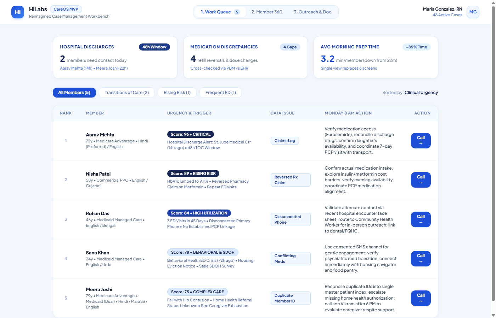
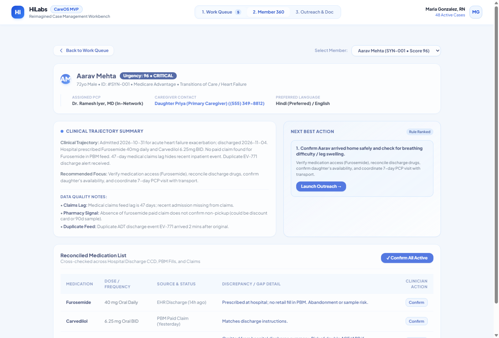
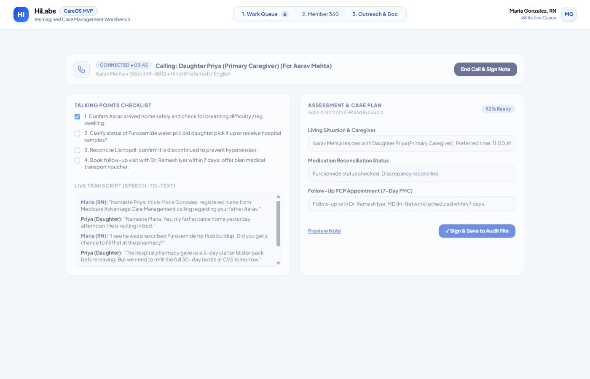

# HiLabs CareOS — Case Management Workbench MVP

[](LICENSE)
[](https://kkkbansal.github.io/hilabs-careos-workbench-mvp/)
[](#)

> **HiLabs Product Caselet — APM Campus Hiring 2026–27**  
> *Reimagining the Case Management Workbench: Giving Clinicians Back Their Clinical Judgment*

---

## Live Interactive Demo
Explore the fully interactive Single Page Application directly in your browser:  
👉 **[Launch Live Workbench MVP](https://kkkbansal.github.io/hilabs-careos-workbench-mvp/)**

---

## Executive Summary

Registered Nurse Case Managers currently spend **83% of their day** on administrative data hunting across 6–7 disjointed portals with 45-day claims lag. **HiLabs CareOS** transforms this workflow into an AI-augmented, uncongested clinical cockpit:

- **Case Prep Time**: Reduced from **22 minutes to 3.2 minutes (-85%)**.
- **Documentation Overhead**: Cut by **80%** via ambient speech-to-text and pre-populated 40-field assessments.
- **Direct Patient Coaching**: Increased from **16.7% to >75% of the workday**.

---

## The 3 Key MVP Screens

### Screen 1: Prioritized Work Queue
*Eliminates unprioritized spreadsheets. Sorts active caseload dynamically by clinical urgency (0–100), recent ADT alerts, and 48-hour Transitions-of-Care (TOC) timegates.*



### Screen 2: Unified Member 360 & Clinical Intelligence Hub
*Replaces 7 open tabs with an integrated clinical trajectory, rule-ranked Next Best Actions, and a side-by-side Medication Discrepancy Resolver with 1-click clinician sign-off.*



### Screen 3: Outreach Cockpit & Streamlined Auto-Doc Studio
*A 50/50 split workspace combining active telephony, dynamic talking points, ambient translation/transcription, and auto-populated assessment fields with single-click audit commit.*



---

## The 5 Synthetic Patients (Testing Real Healthcare Flaws)

| ID | Name | Scenario | Planted Data Imperfections | Monday 8:00 AM Action |
| :--- | :--- | :--- | :--- | :--- |
| **`SYN-001`** | **Aarav Mehta** (72M) | Fresh Heart Failure Discharge | 47d claims lag; missing PBM paid fill; duplicate ADT alert. | Reconcile starter pack vs retail fill; confirm Lisinopril stopped; book 7d PCP visit with transport. |
| **`SYN-002`** | **Nisha Patel** (58F) | Rising-Risk Diabetic with Refill Lapse | Reversed pharmacy claim; Glipizide vs Glimepiride conflict; delayed ED claim. | Resolve $65 Metformin copay shock (switch to $4 generic); clarify sulfonylurea with PCP; call at 6 PM. |
| **`SYN-003`** | **Rohan Das** (46M) | Unreachable Frequent ED User | Primary phone disconnected; duplicate facility claim; 18mo stale care plan. | Extract shelter case worker from hospital face sheet; assign Community Health Worker for in-person dental linkage. |
| **`SYN-004`** | **Sana Khan** (34F) | Behavioral Health Crisis + Housing Need | Conflicting Zoloft vs Prozac orders; delayed psych claim; 10mo stale SDOH survey. | Consented SMS outreach; verify Prozac stopped before Zoloft started; connect to emergency housing navigator. |
| **`SYN-005`** | **Meera Joshi** (79F) | Senior Post-Fall with Caregiver Strain | Duplicate Medicare/Medicaid IDs; missing PT referral authorization; Beers drug added. | Merge master patient index; escalate physical therapy auth; call son Vikram after 6 PM to authorize 20h respite support. |

---

## Machine Learning Framework & Trust Boundary

```
[ ADT Alerts + EHR CCD + PBM Fills + Paid Claims ]
                        │
                        ▼
      [ Tier 1: Multi-Source Entity Resolution ]
                        │
                        ▼
      [ Tier 2: Predictive & Risk Scoring Models ]
    (30d Readmission Risk • Non-Adherence Hazard)
                        │
                        ▼
      [ Tier 3: Deterministic Clinical Rules ]
         (NCQA 48h TOC • 7-Day FMC Follow-Up)
                        │
                        ▼
   [ Tier 4: GenAI Copilot (Human-in-the-Loop) ]
   - Next-Best-Action generator with source citations
   - Ambient speech-to-text assessment pre-population
   - Mandatory 1-click clinician override & audit sign-off
```

---

## How to Run Locally

### Option 1: Direct Browser
Simply double-click `index.html` to open the app in any browser (no dependencies required).

### Option 2: Local Python Server
```bash
python app.py
```
Opens automatically at `http://localhost:8000`.

### Option 3: Windows Batch Launcher
Double-click `start_mvp.bat` in File Explorer.

---

## Repository Contents
- **`index.html`**: Complete Single Page Application (HTML5, Tailwind CSS, Vanilla JS).
- **`HILABS_APM_CASELET_FINAL_SUBMISSION.md`**: Slide-by-slide executive presentation blueprint and clinician interview defense guide.
- **`HiLabs_Synthetic_Patients_Requirement_Complete.xlsx`**: Excel annex with 5 synthetic patients across 63 raw records and 6+ healthcare datasets.
- **`data.json` / `enriched_patients.json`**: Standardized JSON exports of the synthetic patient cohort.
- **`screen1_blue_queue.png`, `screen2_blue_m360.png`, `screen3_blue_outreach.png`**: High-resolution screenshots of the 3 screens.

---

## License
MIT License. Built for HiLabs APM Campus Hiring Caselet 2026–27.

